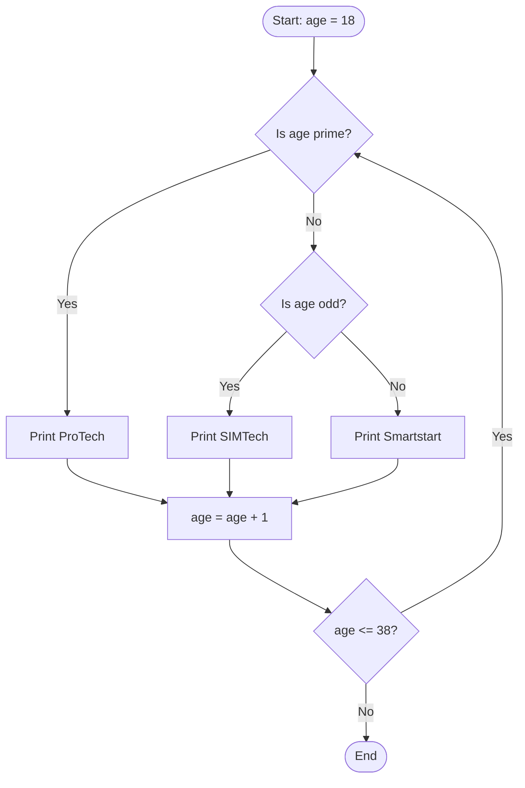

# x86 Assembly (NASM): Computer Systems Coursework

**Module:** CMPC102 Computer Systems, Year 1 (2024–25), University of Roehampton  
**Language:** 32-bit x86 assembly (NASM), Linux `int 0x80` system calls

## Brief (summary)
A university module scenario with 200+ students across four computing departments
(Computer Science 150, Cybersecurity 49, Software Engineering 43, Web Design 15). Write NASM programs to:

1. Print an introduction to my mini-group and declare a constant equal to 200
2. Label students by age: **SIMTech** (odd), **Smartstart** (even), **ProTech** (prime)
3. Add 32 students to the Web Design group
4. Sum the students in all four departments
5. Draw flowcharts for questions 2 and 4

## Contents
| Folder | What it is |
|---|---|
| [`original-submission/`](original-submission) | The four `.asm` files and two flowcharts exactly as submitted in Nov 2024 |
| [`revised/`](revised) | Corrected versions written after submission (Oct 2026) |

## Revisions after submission
Running the original programs showed four bugs, which are fixed in `revised/`:

| Question | Bug in the original | Fix |
|---|---|---|
| Q2 | `len1 equ $ - simtech` was calculated after all three strings, so an odd age printed *SIMTech, Smartstart **and** ProTech* | Each string's length is calculated immediately after it |
| Q2 | `mov ah, al` before `div bl` put the age into the high byte of the dividend, giving wrong remainders | Dividend is zero-extended before `div` |
| Q2 | Prime was only tested for even ages, so odd primes (19, 23, 29…) were labelled SIMTech | Prime is checked first, then odd/even; the program now runs over every age 18–38 |
| Q3, Q4 | The sum was calculated but a hard-coded message was printed | Results are converted to decimal text and printed from the register |
| Q4 | The true total is **257**, not 239, and it overflows an 8-bit register (`AL` wraps to 1) | Values are zero-extended and summed in 32-bit `EAX` |
| Q1 | Exited with status 1 (leftover `EBX`) | `EBX` cleared before `sys_exit` |

### Revised output
```text
$ ./question02          $ ./question03                    $ ./question04
Age 18: Smartstart      New Web Design group size: 47     Total students: 257
Age 19: ProTech
Age 20: Smartstart
Age 21: SIMTech
...
```

### Revised Q2 logic


## Build and run (Linux)
```bash
nasm -f elf32 question01.asm -o question01.o
ld -m elf_i386 -e main question01.o -o question01   # or: gcc -m32 question01.o -o question01
./question01
```

## Concepts used
Registers (`EAX`–`EDX`, `AL`/`AH`), `.data` / `.bss` / `.text` sections, `equ` constants,
`mov` / `movzx` / `add` / `mul` / `div` / `test` / `cmp`, conditional jumps, loops, subroutines (`call`/`ret`, stack
`push`/`pop`), integer-to-ASCII conversion, Linux syscalls `sys_write` and `sys_exit`, and 8-bit overflow.
